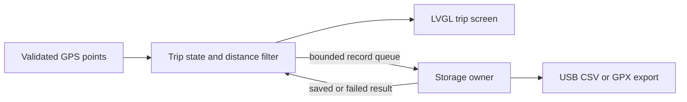

# What to build next with SmartTrack

Recommendation: make the first product a **portable trip tracker and location
logger**. It directly uses the working ESP32-S3, GPS receiver and touchscreen.
The screens and sensor/RTOS groundwork exist; the next substantial work is
reliable records, power and a focused daily-use flow.

These are proposals, not features already installed.

## Three useful product directions

| Direction | First useful experience | Main remaining dependencies |
|---|---|---|
| Portable trip tracker — recommended | Start a trip, see duration/distance, save a place, review the trip and return toward its start | Validated GPS filtering and persistent storage; battery system for portable use |
| Parked-bike tracker | Save parking position, arm monitoring, inspect movement events | Reliable power, repaired/validated motion sensor, false-alarm testing; modem or relay for remote alerts |
| Field survey logger | Save named locations with timestamps and simple category tags, then export a CSV | Storage, useful record IDs/time handling, export flow; good low-connectivity use case |

## A concrete first trip-tracker release

1. **Trip screen:** Start / Pause / Finish, elapsed time, accepted GPS distance,
   GPS fix and freshness. A missing fix pauses position accumulation; it must not
   draw a line across a long gap or accumulate stationary GPS drift as travel.
2. **Saved places:** Save the current valid position with a short preset label
   such as Home, Parking or Checkpoint. Show saved time and distinguish saved
   coordinates from current coordinates.
3. **History and export:** Persist trip summaries and timestamped points. Resume
   or recover cleanly after power loss. Export CSV/GPX through the existing USB
   host connection before adding a separate cloud dependency.
4. **Return to start:** Show distance and bearing to a saved point when the GPS
   fix is usable. A bearing can be north-referenced; a heading-relative arrow
   needs reliable heading information. The current MPU is not a compass. This
   feature does not imply road routing or a standalone street map.
5. **Portable finish:** Add verified battery/charging hardware, measure runtime,
   expose a real battery reading, then build an enclosure that leaves the
   resistive panel accessible. Verify the existing backlight driver before PWM
   dimming; use a wake-only first touch if screen sleep is added.

Start with one coherent flow: **Home → Start trip → Live trip → Finish → Summary**.
Use the existing dark background, clear typography and large controls. Give
GPS readiness and the active trip more space than secondary tools. Keep sensor
diagnostics accessible in Device/Settings. This is a proposed future layout;
the current firmware still has its six-app launcher.

## Hardware choices before implementing storage and battery

- Confirm the exact board and available wiring before assigning microSD CS;
  it is currently unassigned. Do not guess a free GPIO or use the modem pins.
- Choose microSD for substantial journey logs, or a bounded internal-flash ring
  for a small prototype after checking partition use, endurance and power-loss
  recovery. NVS is suitable for small settings, not continuous track recording.
- Identify the battery, charger/protection board and supply path before wiring.
  Battery percentage requires a real measurement/gauge and calibration.
- Keep the current resistive panel for this prototype if its feel is acceptable.
  A compatible capacitive assembly is a later hardware improvement.
- Repair/validate intermittent MPU and modem communication before features rely
  on them. GPS trip logging can be developed independently of motion alerts and
  cellular delivery.

## How FreeRTOS fits

Keep building with PlatformIO and the existing FreeRTOS framework. The current
MPU worker already isolates I²C retries from the UI. The next useful owner is a
storage task, added when persistent journey logging is implemented:

Persist record identity, trip ID, boot ID, sequence, uptime, optional UTC time,
GPS validity and coordinates only when valid. Storage success must be reported
separately from displaying a point. A full queue or write failure should be
visible; it must not block touch handling or silently report a saved journey.

Keep cloud dashboards, geofences and SOS for later increments with explicit
delivery/acknowledgement behavior. See [PRODUCT-REVIEW.md](PRODUCT-REVIEW.md) for
feature priorities and [RTOS-PLAN.md](RTOS-PLAN.md) for ownership details.
