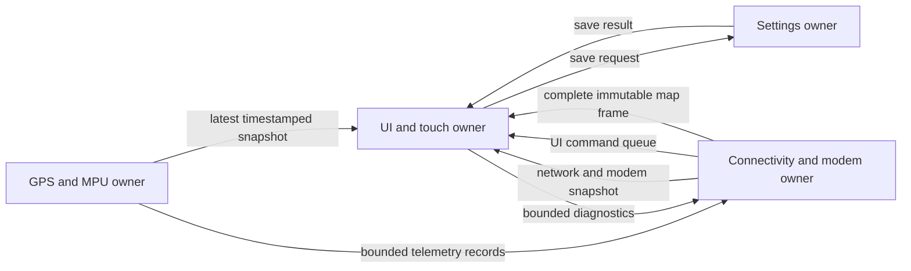

# SmartTrack display and RTOS engineering plan

Source review: 2026-11-04. Target: the local `gps-firmware` on ESP32-S3,
ILI9341 320 × 240 display and XPT2046-compatible resistive touch. This document
records the baseline reviewed at the start of the touch improvement work and a
staged architecture. It is not evidence that every proposed task is implemented
or that any timing target has passed on the device. Consult the current source,
change log and verification report for installed behavior.

## Implemented first task split

The current source now implements the minimal MPU split in
`gps-firmware/src/mpu_runtime.cpp`. Firmware installation and physical timing
remain separate checks owned by the main verification workflow.

| Owner | Implemented behavior |
|---|---|
| Arduino loop | Sole LVGL/display/touch/map/USB/network/modem owner; consumes MPU snapshots and emits queued MPU telemetry |
| `smarttrack-mpu` | FreeRTOS priority 1, unpinned, 4,096-byte initial stack, 5 ms delay between iterations; sole `Wire` and MPU state owner |
| Snapshot queue | Length 1, overwrite/copy semantics; latest validity, sensor values, sample timestamp, sequence and health counters |
| MPU telemetry queue | 16 complete records, each up to 639 bytes plus terminator; main drains at most 4 per loop; overflow or formatting truncation increments drop count |

Existing `MPU_INFO`, `MPU_SAMPLE` and `MPU_ERROR` contracts are preserved. The
worker never invokes the application's `TelemetryStream`. A wireless reconnect
notifies the worker to verify configuration; it does not run I²C from the loop.
Task/queue creation failure reports `rtos_start_failed`, leaves MPU unavailable
and continues the display; there is no blocking sensor fallback on the UI task.
After a probe, the published sensor is unavailable until an actual sample
arrives. A configuration write does not refresh the timestamp of old readings.

The read-only `RTOS_STATUS` command, also emitted every five seconds, reports
uptime, maximum loop-start gap in microseconds, task creation state, snapshot
age, last sample age (`null` before the first sample), queue depth/drops, maximum
worker step duration and minimum remaining worker stack in bytes. Worker step
duration includes I²C/reset waits; these waits now occur in the separate worker.
The loop gap still includes graphics/commands and is distinct from the touch
sample gap because the touch path can service input between display stripes.

`test_mpu_runtime.py` compiles the actual task adapter against host queue/I²C
fakes with AddressSanitizer and UndefinedBehaviorSanitizer. Seven scenarios
exercise healthy acquisition and JSON contracts, configured hardware without
a sample, absent hardware, queue overflow, task creation failure and each queue
allocation failure. They also verify that initialization/notification do not
perform I²C on the caller, snapshot overwrite and complete-record framing.
These tests passed during implementation; they simulate the boundary and do
not establish scheduling or electrical behavior on the board.

### Remove delayed radio initialization from live UI work

The first live check of the task split observed an approximately 388 ms touch
sample gap near the old 30-second recovery-AP deadline. The scheduled path was
`WiFi.mode(AP_STA)` → `WiFi.softAP()` → telemetry/OTA service initialization on
the UI/network owner. That correlation identified the delayed radio setup as
the next path to remove; the individual calls were not timed in that earlier
image.

The revised source starts the existing protected recovery AP and its services
inside `wirelessBegin()`, before `launcherBegin()`. Saved station Wi-Fi still
joins/retries, and the recovery AP now remains available from startup even when
the saved network succeeds. Password derivation, authentication, NVS schema and
network ownership are unchanged. There is no delayed or repeating live AP
creation path. A failed AP setup reports failure and is retried on restart or
explicit configuration, with USB still available.

`WIFI_STARTUP`, `WIFI_RADIO_SETUP`, `WIFI_RECONNECT` and corresponding
`WIFI_STATUS` fields measure startup, AP mode/create, service startup and
explicit station reconnect durations. The 15-second station reconnect remains
in the network owner and is measured separately. Input/loop timing maxima are
not cleared or hidden by this change. Verify the new image for at least 45–60
seconds, crossing both the former 30-second deadline and several reconnects,
and record its own firmware identity; the earlier image's timing is not proof
of the revised image's performance.

## Build on the RTOS already present

The Arduino-ESP32 framework already runs on Espressif's FreeRTOS. The product
work is to give time-sensitive functions clear owners, bounded execution times,
queues and recovery paths. A new kernel would add scheduling, interrupt, memory,
driver and debugging work without improving this product's display.

Keep the existing PlatformIO build, working GPIO assignments, saved touch
calibration and OTA partitions while improving the application. The remote
Windows project's firmware uses different GPS pins and feature defaults; it
must be reconciled before replacement, as described in
[`../REMOTE-PROJECT-REVIEW.md`](SERVER_ACCESS.md).

## Why a quick tap can be missed

The reviewed `main.cpp` runs wireless service, GPS receive, MPU work, modem
diagnostics, USB/network commands and display service sequentially in Arduino's
loop task. The final `delay(1)` yields to FreeRTOS, but does not place a maximum
duration on everything before it.

| Reviewed path | Evidence in source | Consequence |
|---|---|---|
| Touch sampling | `launcher.cpp` samples every 20 ms before `lv_timer_handler()`; LVGL input default is also 20 ms | A brief contact can fall between samples, especially during rendering |
| Display transfer | `display.cpp` uses 10 MHz SPI; launcher draw buffer is 12 rows | A full 320 × 240 RGB565 redraw needs at least 122.88 ms of wire time, excluding setup/rendering; the small buffer alone does not make the handler nonblocking |
| MPU retry | `mpuProbe()` retries after 3 s, uses 20 ms I²C timeouts and explicit 100 ms + 30 ms waits after successful identity/reset steps | Sensor faults or reconnection can produce long gaps before the next touch sample; exact gaps depend on which step fails |
| Normal modem diagnostics | `ModemDiagnostics::tick()` reads at most 192 bytes and advances a deadline-based state machine | Already suitable for cooperative servicing; a missing AT response need not freeze the screen |
| Explicit legacy SMS command | `modemTransaction()` waits up to 3 s, 5 s and 30 s across its stages; it only services wireless during waits | Invoking this command can freeze the current UI; routine navigation does not invoke SMS |
| Network telemetry | TCP output is bounded and uses `MSG_DONTWAIT`; USB writes first check capacity | Useful existing backpressure controls; do not replace with blocking writes |
| Firmware update | `ArduinoOTA.handle()` runs in the loop and update callbacks announce acquisition is paused | Update mode has different availability guarantees; normal touch latency cannot be promised during flash writes |

The resistive panel also needs physical pressure to make contact. Software can
remove unnecessary hold time and avoid losing detected taps; it cannot turn
this panel into capacitive glass that responds to feather-light contact. A
short firm tap or plastic stylus should be the intended normal interaction.

## First increment: make the current ownership responsive

1. Give input acquisition its own short service interval, initially 5–10 ms.
   Keep noise rejection, calibrate raw coordinates, and retain press/release
   transitions until LVGL consumes them. A held contact must produce only one
   ordinary button action. A short invalid sample should not manufacture a
   release followed by a second click.
2. Sample between completed LCD stripe transfers. The LCD transaction and chip
   select must be released before starting a touch transaction on the shared
   bus. Never call the LVGL timer handler recursively from its flush callback.
3. Replace long sensor reset/configuration sleeps with dated states, or isolate
   the whole I²C owner behind a task and copied messages. Keep missing sensors
   from delaying navigation.
4. Instrument maximum input sample gap, draw duration, loop/service duration,
   retained or dropped input events, free internal heap and task stack margin.
   A configured 5 ms interval is a target, not a measured worst-case bound.
5. Preserve incremental repainting. Repaint changed labels and pressed feedback;
   avoid full-screen animations or continual page reconstruction at 10 MHz SPI.
   Raising SPI speed requires hardware validation with the actual wiring.

Ordinary application navigation should accept a quick tap. A dedicated
calibration procedure may deliberately ask the user for a stable contact and
release at each target because it estimates the coordinate transform. This
should be explained as setup behavior, not the normal way to open apps.

## Second increment: separate slow peripherals safely

The smallest useful task split is one MPU task that exclusively owns `Wire`,
probe state and raw samples. Publish a copied snapshot to the existing loop,
which remains the only owner of LVGL, LCD/touch SPI, map reception, commands and
the current `TelemetryStream`. This isolates I²C timeouts without creating
concurrent access to every existing global.

Start with an ordinary application priority such as 1 for the MPU worker and a
20 ms healthy sample period. Retry missing hardware on a longer deadline,
currently 3 s. Begin with an internal-RAM stack budget around 4 KiB, then measure
the minimum remaining stack under error/reprobe conditions. These are initial
engineering values, not verified memory requirements. Check the pinned
Arduino/ESP-IDF API's stack-size units; Espressif's task creation APIs differ
from generic FreeRTOS examples.

A queue of length 1 with overwrite semantics is appropriate for a latest MPU
snapshot: old readings are superseded, not accumulated. Include sample time,
sequence, validity, hardware identity and error state so the UI can explicitly
expire stale readings. The publishing task must not mutate a snapshot that the
receiver is reading.

Diagnostic text from a worker must pass through a bounded event queue to the
telemetry owner. The existing network ring buffer and client object are not a
cross-task logging API. Preserve complete records; count queue overflow and
report loss instead of silently joining partial lines. Do not hold a state lock
while formatting text, writing serial, talking to I²C or waiting for a queue.

## Product architecture after the first split is measured

The following table is a proposed end state. Higher numeric FreeRTOS priorities
run first. Keep application priorities modest and leave framework Wi-Fi/USB
tasks able to run. Core affinity is a measurement decision; core 0 already does
network work, so simply putting all new tasks there is not isolation.

| Owner | Initial priority / service target | Owns | Communication |
|---|---|---|---|
| UI + touch | Priority 2; input every 5–10 ms; changed content around 25–50 ms | All LVGL APIs, LCD SPI and touch SPI, page state, pressed feedback, calibration flow | Receives copied snapshots and UI command events; sends settings requests |
| Sensor acquisition | Priority 2; GPS drain in bounded chunks; MPU 20 ms while healthy | GPS UART/parser and MPU I²C/state machine, acquisition timestamps | Publishes latest snapshots; emits bounded error events |
| Connectivity + modem | Priority 1; bounded receive/transmit each iteration | Modem UART/state machine, Wi-Fi client, transport parser, telemetry queues | Receives telemetry/control records; publishes modem/network state and routes UI commands |
| Storage | Priority 1; event driven | Persistent settings and future validated local journey storage | Receives explicit save requests; returns success/failure; never blocks UI callback |
| Health reporting | Priority 1; about 1 s | Progress counters and measured task health | Reports stale owners, queue pressure, heap and stack margin; no indiscriminate watchdog feeding |

The extra storage and health owners are optional until there is enough real
work to justify separate tasks. A small number of clear owners is easier to
measure and recover than one task per feature.

### Ownership rules that prevent new bugs

- All LVGL calls stay on the UI owner, including `UI_HOME`, screenshots,
  calibration commands and display diagnostics. Queue commands instead of
  calling launcher functions directly from another task.
- LCD and touch share GPIO11/12/13 and one SPI controller. Keep one owner, or
  protect every transaction with the same mutex if a split is unavoidable.
  An IRQ should only notify a task; it must not draw, allocate, print or perform
  SPI transfers. Do not rely on IRQ15 until actual wiring is verified.
- `tftMap` currently has two mutable frame buffers and is not thread-safe.
  A producer must validate length/CRC before handing off an immutable completed
  frame. Return ownership after the UI copies/consumes it. Do not merely share a
  frame pointer that the next transfer can overwrite.
- Copy `DisplayData` and `ModemStatus`; do not read concurrently changing globals
  or retain a reference returned by `modem.status()` across task boundaries.
- Touch calibration writes must report persistence failure and preserve the
  previous valid transform. Flash/NVS writes can still stall execution at the
  framework level, so measure them even after adding a storage task.
- OTA is a deliberate maintenance state. Pause conflicting storage operations,
  retain the previous bootable slot and record image identity after restart.
  Do not promise normal responsiveness while an image is being written.
- ISR-safe queues/notifications are only required when invoked from an ISR.
  Ordinary task code should use normal queue APIs with bounded or zero waits.

## Verification gates

Build and existing host tests establish compile-time compatibility and parser
behavior. They do not establish physical touch responsiveness. Record these
additional device checks with firmware identity and transport:

| Check | Acceptance target / evidence |
|---|---|
| Short taps | Repeat 50–100 ms contacts across all tiles and navigation controls; exactly one action per contact, including during page changes |
| Held contact | Hold for several seconds; no repeated navigation or stopwatch toggles |
| Noisy contact | Brief dropout and boundary motion do not create multiple actions; release rearms the next deliberate tap |
| Rendering load | Input remains sampled during redraw/map updates; distinguish input detection latency from completion of the full screen transfer |
| Sensor fault/recovery | Missing or responding MPU and missing modem do not pause navigation; state expires honestly |
| Queue pressure | Slow/disconnected telemetry consumer cannot block UI; complete records and explicit drop counters |
| Persistence | Reboot retains calibration/settings; failed save leaves a valid prior configuration |
| Longevity | Measure max sample/service gap, heap and minimum stack over a sustained mixed workload; verify counters rather than relying on an idle screenshot |
| Update/recovery | Application-only flash preserves NVS; recorded image identity matches the built image; normal service resumes after update |

Aim for accepted-input/pressed-feedback latency below 50 ms in ordinary use,
then report the measured distribution and worst observed gap. Full-screen
navigation can take longer on the existing SPI display. An external camera or
logic analyzer is needed for a defensible physical contact-to-photon latency
measurement; timestamps inside the firmware only establish software intervals.

This source review did not operate USB, test the physical panel, send SMS, or
verify the proposed task arrangement on hardware.
